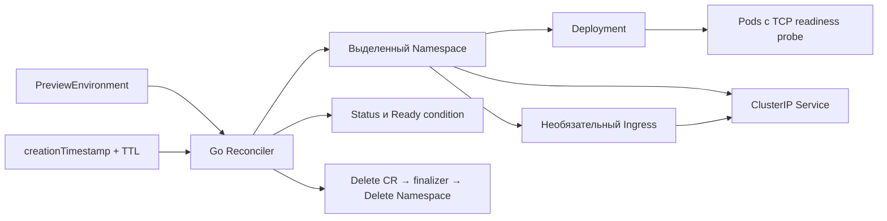

# PreviewForge

[](https://github.com/T1mof/previewForge/actions/workflows/operator-e2e.yml)

PreviewForge — Kubernetes Operator на Go для изолированных тестовых окружений. Пользователь создаёт cluster-scoped `PreviewEnvironment`; оператор создаёт Namespace, Deployment и Service, согласовывает состояние и удаляет окружение по TTL.

Реализована основа этапа 1; 2026-10-27 настоящий lifecycle в локальном kind прошёл все 13 проверок, включая HTTP, рестарт, TTL и полное удаление Namespace и тестового кластера. Команды для WSL2 и Git Bash описаны в [VERIFICATION.md](docs/VERIFICATION.md); реальные результаты — в [TESTING.md](docs/TESTING.md). GitHub Actions также прошёл: [run 40576650171](https://github.com/T1mof/previewForge/actions/runs/40576650171), оба job SUCCESS; [отчёт с проверенным artifact](docs/verification/2026-10-27-stage1.md). Этап 1 завершён. Автоматическая связь с Pull Request относится к этапу 2.



## Что реализовано

- CRD `platform.previewforge.dev/v1alpha1` с валидацией, значениями по умолчанию и status subresource.
- Namespace с именем на основе имени и UID CR; проверка controller owner reference перед изменениями.
- Deployment с CPU/memory requests и limits, TCP readiness probe; Service типа ClusterIP.
- Настраиваемые CPU/memory, ResourceQuota/LimitRange и профили Pod Security baseline/restricted: [контракт и ограничения](docs/RESOURCE-CONTROLS.md).
- Необязательный Ingress с явными host/class, ссылкой на TLS Secret и `status.url`; безопасное отключение, исправление drift и watch восстановления.
- Фазы `Pending`, `Deploying`, `Ready`, `Failed`, `Expired`, condition `Ready`, диагностические сообщения.
- Исправление управляемых полей, восстановление удалённых ресурсов, повторная обработка ошибок API.
- TTL от времени создания CR и finalizer, ожидающий фактического удаления Namespace.
- Watch дочерних ресурсов, четыре reconcile worker, optimistic locking, leader election в Deployment оператора.
- Unit-тесты, envtest suite для Linux/macOS и сценарий e2e в выделенном kind-кластере.
- Предметные inventory metrics из Kubernetes, HTTPS endpoint с authn/authz, optional Prometheus/Grafana demo и dashboard: [наблюдаемость](docs/OBSERVABILITY.md).
- CLI `previewctl`, отдельный deployer RBAC, example Go HTTP server и выключенный PR workflow: immutable image, актуальный head, update/close и проверка владельца по UID. [Подготовка отдельного кластера](docs/PR-INTEGRATION.md); размещение и внешний PR lifecycle будут проверены позже.

Namespace обеспечивает разделение ресурсов и удаление окружения целиком. Сетевая изоляция между Namespace ещё не реализована: для неё необходимы NetworkPolicy и совместимый CNI. По умолчанию приложение доступно внутри кластера; внешний HTTP(S) включается через необязательный Ingress. API, URL и локальный demo описаны в [INGRESS.md](docs/INGRESS.md).

## Зависимости и структура

Go 1.26+, controller-runtime 0.25.2, `k8s.io/*` 0.37.0, controller-gen 0.22.0. Dockerfile использует Go 1.26.9; kind-сценарий — kind 0.33.0 и Kubernetes 1.37.0. Версии закреплены в `go.mod` и Makefile. Используется структура Kubebuilder Go v4; CLI Kubebuilder для сборки не нужен. Module path `github.com/T1mof/previewForge` соответствует [репозиторию проекта](https://github.com/T1mof/previewForge).

```text
api/v1alpha1/       CRD types и сгенерированный DeepCopy
cmd/manager/       entrypoint, manager, сигналы и health probes
cmd/previewctl/    apply/get/delete PR окружений через явный kubeconfig/context
internal/controller/ reconcile, ресурсы, тесты
internal/prenvironment/ PR binding, optimistic apply и UID/RV delete
examples/hello/    пример приложения с revision и health endpoint
config/            сгенерированные CRD/RBAC, Deployment и пример CR
scripts/           проверки Windows, kind demo и e2e
docs/              ТЗ, архитектура, решения, roadmap и результаты проверок
```

## Локальные проверки

В PowerShell, из корня проекта:

```powershell
.\scripts\check.ps1
# При изменении API types или RBAC markers:
.\scripts\check.ps1 -Generate
```

Скрипт использует кеши `.cache/` и бинарники `bin/` внутри проекта. Нужны Go и kubectl; `kubectl kustomize` работает без подключения к кластеру. Если политика PowerShell запрещает запуск локальных скриптов, используйте отдельный процесс `powershell -ExecutionPolicy Bypass -File .\scripts\check.ps1`.

В Linux/macOS:

```bash
make manifests
make vet test build
make test-race
make test-integration
```

Интеграционные тесты скачивают API server и etcd через setup-envtest. Envtest не запускает Pod и не предоставляет Deployment controller, namespace controller или GC. Тест явно моделирует готовность Deployment; HTTP и завершение удаления Namespace проверяются в e2e. Интеграционные тесты включаются только build tag `integration` и не маскируют отсутствие среды успешным skip.

## Быстрый запуск в kind

Нужны Linux/WSL или macOS, работающий Docker Engine, Go, make, kubectl и Bash. Скрипт создаёт новый кластер `previewforge-test-<random>`, отказывается использовать существующий и сохраняет kubeconfig в `bin/runs/<cluster>/kubeconfig` с удобной копией `bin/kind.kubeconfig`. Затем строит image, загружает его в kind и ждёт Ready.

```bash
make kind-demo
export KUBECONFIG="$PWD/bin/kind.kubeconfig"
CONTEXT=$(kubectl config current-context)
NS=$(kubectl --context "$CONTEXT" get previewenvironment pr-42 -o jsonpath='{.status.namespace}')
kubectl --context "$CONTEXT" -n "$NS" port-forward svc/app 8080:80
# В другом терминале: http://localhost:8080
```

В Windows после запуска Docker Desktop есть вариант без make и Bash:

```powershell
.\scripts\kind-demo.ps1
$taskConfig = Join-Path $PWD 'bin\kind.kubeconfig'
$taskContext = kubectl --kubeconfig $taskConfig config current-context
$taskNamespace = kubectl --kubeconfig $taskConfig --context $taskContext get previewenvironment pr-42 -o 'jsonpath={.status.namespace}'
kubectl --kubeconfig $taskConfig --context $taskContext -n $taskNamespace port-forward svc/app 8080:80
```

PowerShell-скрипт при необходимости установит kind 0.33.0 в `bin/`. Пользовательский kubeconfig не изменяется. Envtest следует запускать в Linux/WSL.

Полный воспроизводимый сценарий:

```bash
make test-e2e
```

Полный e2e дополнительно требует Python 3 для проверки image metadata. `make build` собирает manager и `previewctl`; в Git Bash предварительно соберите `bin/previewctl.exe`, как показано в [VERIFICATION.md](docs/VERIFICATION.md).

Он проверяет настоящие Ready/Pod и HTTP через Service DNS/ClusterIP, запрет Ready до готовности приложения, исправление replicas, восстановление Deployment, рестарт, TTL при работающем операторе и после простоя, удержание finalizer и отказ изменения/удаления чужих ресурсов. E2e сохраняет диагностику в `bin/runs/<cluster>/artifacts`, затем удаляет только созданный им кластер, в том числе при ошибке. Demo для ручной работы сохраняет кластер.

В Windows полный e2e также можно запустить через Git Bash без WSL Integration; команды приведены в [VERIFICATION.md](docs/VERIFICATION.md#полный-e2e-в-git-bash-без-wsl-integration).

Ingress подтверждён [CI с 14 проверками](https://github.com/T1mof/previewForge/actions/runs/40582139866); [отчёт](docs/verification/2026-10-28-ingress.md) содержит source SHA и artifact digest.

Подготовка PR-интеграции подтверждена [CI с 15 проверками](https://github.com/T1mof/previewForge/actions/runs/40640242526) и независимой проверкой artifact: [отчёт](docs/verification/2026-10-28-pr-integration.md). Внешний PR workflow выключен; fixture metadata в kind не заменяет будущую проверку настоящих PR в отдельном кластере.

Metrics/Prometheus/Grafana подтверждены [CI с 16 проверками](https://github.com/T1mof/previewForge/actions/runs/40745877197): HTTPS auth, inventory после рестарта/удаления, rule tests и запросы девяти панелей. [Отчёт](docs/verification/2026-10-28-metrics.md) содержит source SHA, artifact digest и ограничения локального прогона.

ResourceQuota/LimitRange и Pod Security подтверждены [CI с 17 проверками](https://github.com/T1mof/previewForge/actions/runs/40890879045) и локальным kind 17/17 с cleanup: restricted app Ready, реальные admission-отказы опасных и превышающих бюджет Pod, watch-восстановление и cleanup. [Отчёт и проверенный artifact](docs/verification/2026-10-29-resource-controls.md).

Демонстрация приложения в браузере: `make ingress-demo` или `bash scripts/ingress-demo.sh` из настроенного Git Bash. Новый локальный kind получает loopback listener и настоящий Traefik; скрипт проверяет HTTP и оставляет кластер для работы. По умолчанию URL — `http://localhost:8080`. [Инструкция и cleanup](docs/INGRESS.md#локальный-demo).

При недоступном локальном Docker есть [GitHub Actions workflow](.github/workflows/operator-e2e.yml): Linux race/envtest, затем отдельный kind на GitHub-hosted Ubuntu с автоматической очисткой и проверкой полноты результатов. Подготовленный workflow не означает состоявшийся CI-прогон. Инструкция запуска и критерии успешного результата — в [VERIFICATION.md](docs/VERIFICATION.md). Остаточные риски и минимальные меры защиты — в [SECURITY.md](docs/SECURITY.md).

## Запуск контроллера вне кластера

В отдельном локальном тестовом кластере установите CRD, затем запустите процесс с kubeconfig пользователя, которому разрешено управлять нужными ресурсами:

```bash
export KUBECONFIG="$PWD/bin/kind.kubeconfig"
CONTEXT=$(kubectl config current-context)
kubectl --context "$CONTEXT" apply -k config/crd
go run ./cmd/manager --kubeconfig bin/kind.kubeconfig
```

В другом терминале:

```bash
export KUBECONFIG="$PWD/bin/kind.kubeconfig"
CONTEXT=$(kubectl config current-context)
kubectl --context "$CONTEXT" apply -f config/samples/platform_v1alpha1_previewenvironment.yaml
kubectl --context "$CONTEXT" get previewenvironments -w
kubectl --context "$CONTEXT" wait --for=condition=Ready previewenvironment/pr-42 --timeout=180s
kubectl --context "$CONTEXT" get previewenvironment pr-42 -o yaml
```

Для запуска внутри кластера примените `config/default` после сборки и загрузки `previewforge:dev`. RBAC и ServiceAccount уже включены. При смене image отредактируйте `config/manager/manager.yaml` или используйте Kustomize overlay.

## API и TTL

```yaml
apiVersion: platform.previewforge.dev/v1alpha1
kind: PreviewEnvironment
metadata:
  name: pr-42
spec:
  image: nginx:alpine
  replicas: 2
  port: 80
  ttlSeconds: 3600
```

`image` обязателен. По умолчанию `replicas=1`, `port=80`, `ttlSeconds=3600`. Допустимы 1–10 реплик, порты 1–65535, TTL 1–604800 секунд. Изменение TTL пересчитывает дедлайн от исходного `creationTimestamp`; оно не начинает новый срок от момента изменения. Изменение image/port/replicas обновляет Deployment/Service.

После истечения TTL CR переводится в `Expired`, получает запрос удаления и исчезает после очистки Namespace. Фаза `Expired` временная. История удалённых CR в этом этапе не хранится. Ручное удаление использует тот же finalizer:

```bash
kubectl --kubeconfig bin/kind.kubeconfig delete previewenvironment pr-42
```

## Диагностика

Смотрите `status.message`, `status.conditions` и `status.observedGeneration`, затем Deployment, Pod events и логи оператора. Колонка `EXPIRES` показывает абсолютное время истечения TTL в RFC3339 (UTC). `Failed` не является необратимым состоянием: ошибки API повторяются с backoff workqueue, rollout продолжает проверяться.

Если чужой ресурс занимает рассчитанное имя, оператор откажется его менять или удалять. При конфликте Namespace удаление CR останется заблокированным finalizer; сначала выясните причину и принадлежность Namespace. Не снимайте finalizer без проверки оставшихся ресурсов.

Подробности: [архитектура](docs/ARCHITECTURE.md), [решения](docs/DECISIONS.md), [roadmap](docs/ROADMAP.md), [проверки](docs/TESTING.md), [исходное ТЗ](docs/SPECIFICATION.md). Лицензия: [MIT](LICENSE).
