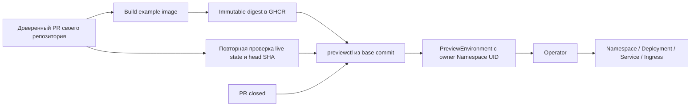

# Подготовка PR-интеграции

Пользователь выбрал подготовить интеграцию для отдельного кластера, а площадку и домен определить позже. Поэтому workflow [preview-pr.yml](../.github/workflows/preview-pr.yml) **выключен по умолчанию**: без repository variable `PREVIEWFORGE_PR_ENABLED=true` оба job пропускаются. Operator verification продолжает проверять только новые kind-кластеры на GitHub-hosted runner.

Внешний кластер сейчас не подключён, kubeconfig/домен для PR не настроены и реальные постоянные PR-ссылки не заявляются. Локальный компонентный e2e использует fixture PR metadata и настоящий Kubernetes: CLI, ServiceAccount RBAC, сборку двух image, rollout, Ingress HTTP и cleanup.

## Поток данных



Нет отдельной БД или локального реестра окружений. Имя CR — `pr-<repository ID>-<PR number>`, host — `pr-<repository ID>-<PR number>.<base domain>`. Числовой ID GitHub устойчив к переименованию репозитория. Образ передаётся только как `...@sha256:<digest>`; commit сохраняется в annotation.

Source Namespace `previewforge-pr-source` создаётся администратором отдельного кластера. Его UID записывается в настройку workflow и проверяется CLI перед операциями. CR получает controller owner reference на этот Namespace с точным UID и `blockOwnerDeletion=false`. Это допустимая связь cluster-scoped объектов; deployer не получает разрешение на Namespace finalizers. Оператор создаёт дочерние ресурсы с owner reference на UID самого CR.

Чужой CR с тем же именем или поддельными labels не принимается под управление и не удаляется. Patch использует optimistic locking; Delete — UID/resourceVersion. Повтор Delete после конфликта разрешён только для той же UID: замена объекта останавливает операцию. Apply сохраняет creationTimestamp, namespace и историю finalizers/status; TTL считается от первого создания и не перезапускается при обновлении image.

## CLI

```bash
go build -o bin/previewctl ./cmd/previewctl
bin/previewctl apply \
  --kubeconfig bin/preview-deployer.kubeconfig --context preview-deployer \
  --source-uid '<UID подготовленного source Namespace>' \
  --repository-id 123 --pr-number 42 \
  --image 'ghcr.io/owner/repo-preview-app@sha256:<64 hex digits>' \
  --revision '<полный commit SHA>' --port 8080 --security-profile restricted \
  --host pr-123-42.preview.example.com --ingress-class traefik \
  --ttl-seconds 3600 --wait --timeout 5m
```

`get` и `delete` используют те же явные kubeconfig/context/source UID/repository ID/PR number. `delete --wait` ждёт исчезновения исходной UID CR; новый объект с тем же именем остаётся нетронутым. Finalizer оператора гарантирует ожидание удаления Namespace. CLI выдаёт JSON и не выводит credentials. Отсутствующий или изменённый source Namespace — ошибка, а не успешное «уже удалено».

## Права и границы доверия

PR example image поддерживает restricted: UID 65532, read-only root filesystem, drop ALL и `/tmp` emptyDir. Workflow явно передаёт этот профиль. CPU/memory можно задать флагами `--cpu-request`, `--memory-request`, `--cpu-limit`, `--memory-limit`; defaults и Namespace budgets описаны в [RESOURCE-CONTROLS.md](RESOURCE-CONTROLS.md). Сохраняйте профиль при повторном apply: API запрещает downgrade restricted.

[config/pr-deployer](../config/pr-deployer/kustomization.yaml) устанавливается отдельно от оператора. ClusterRole генерируется controller-gen из Go markers:

- `get` только Namespace `previewforge-pr-source`.
- `get/create/patch/delete` PreviewEnvironment.
- Нет записи Namespace, Deployments/Pods, Secrets, status subresource или RBAC; отдельные права `/finalizers` не выдаются.

Kubernetes RBAC не ограничивает PreviewEnvironment по owner UID: owner-проверки реализует CLI. Право patch основного CR также позволяет менять metadata, включая finalizers; отсутствие отдельного `/finalizers` permission не защищает их от прямого patch. CLI finalizers не изменяет. Скомпрометированный deployer token может обойти CLI, поэтому требуется отдельный demo-кластер без production credentials/ценных данных. Пользователи с правом изменять доверенные workflow считаются доверенными к preview-доступу. GitHub Environment `preview` позволяет дополнительно включить reviewers и branch restrictions.

Fork PR и авторы вне OWNER/MEMBER/COLLABORATOR пропускаются; `pull_request_target` не используется. Build job имеет packages write, но не подключает Environment с кластерным Secret. Deploy job использует CLI и скрипт проверки из **base commit**, перечитывает live PR state/head через GitHub API и пропускает устаревший build или прежнее close после reopen. Общая per-PR concurrency не прерывает активную операцию. Между GitHub и Kubernetes нет атомарной транзакции: события обеспечивают повторное согласование, TTL остаётся ограничением времени жизни при потерянном close/ошибке CI.

## Что потребуется для включения

1. Новый отдельный demo-кластер, доступный GitHub-hosted runner, с установленными PreviewForge и Ingress controller, DNS на выделенном preview-домене. Текущий example image рассчитан на linux/amd64. User/production kubeconfig не используется.
2. Администратор устанавливает optional `config/pr-deployer` и фиксирует UID source Namespace. Первичная установка должна создавать новые ресурсы; неизвестный существующий source Namespace или одноимённый RBAC нельзя автоматически принимать под управление. Для обычного обновления source Namespace не пересоздаётся.
3. Отдельный kubeconfig только для ServiceAccount `previewforge-pr-deployer`. API server CA проверяется, context задан явно. Временный TokenRequest token нужно обновлять после истечения; окончательная схема короткоживущего доступа/OIDC зависит от выбранной площадки.
4. GitHub Environment `preview` получает Secret `PREVIEWFORGE_KUBECONFIG` и variables из таблицы ниже. Защиты Environment настраиваются до включения.
5. GHCR package для открытого example должен разрешать anonymous pull. GitHub может создать [новый package приватным](https://docs.github.com/en/packages/working-with-a-github-packages-registry/working-with-the-container-registry); build job проверяет pull после logout и останавливается до обращения к кластеру, если image недоступен. При первом build настройте видимость package и rerun. Это явное решение администратора; workflow сам не меняет видимость. Private registry credentials/per-Namespace imagePullSecrets в этот demo workflow не включены.
6. Repository variable `PREVIEWFORGE_PR_ENABLED=true` устанавливается последней. Затем проверяются настоящий same-repository PR, обновление image, HTTP и закрытие с исчезновением CR/Namespace. До этой проверки внешний PR lifecycle остаётся NOT RUN.

| Настройка | Где | Смысл |
| --- | --- | --- |
| PREVIEWFORGE_PR_ENABLED | Repository variable | Явное включение, только строка `true` |
| PREVIEWFORGE_KUBECONFIG | Environment `preview` Secret | Credentials ограниченного deployer, не admin |
| PREVIEWFORGE_KUBE_CONTEXT | Environment variable | Явный context из этого kubeconfig |
| PREVIEWFORGE_SOURCE_UID | Environment variable | UID подготовленного source Namespace |
| PREVIEWFORGE_BASE_DOMAIN | Environment variable | Выделенный DNS suffix |
| PREVIEWFORGE_INGRESS_CLASS | Environment variable | Установленный IngressClass |
| PREVIEWFORGE_TLS_SECRET | Environment variable, optional | TLS Secret, отдельно provisioned в каждом preview Namespace |
| PREVIEWFORGE_TTL_SECONDS | Environment variable, optional | 1–604800 секунд от creationTimestamp, default 3600 |

После apply workflow проверяет с runner настоящий `/healthz` example приложения и требует HTTP 200 с `ok`, затем проверяет revision в JSON ответа `/`. `status.url` само по себе остаётся адресом настроенного маршрута. TLS/certificate provisioning, публичный DNS, OIDC и размещение входят в последующую настройку выбранного кластера.

## Example приложение и воспроизведение

[examples/hello](../examples/hello/main.go) — небольшой Go HTTP server на 8080. `/` возвращает JSON с исходным commit, `/healthz` — `ok`; при SIGTERM выполняется shutdown. [Dockerfile](../examples/hello/Dockerfile) собирает статический binary и запускает его non-root из scratch.

`make manifests` генерирует обе роли, `make build` — manager и previewctl. `make test-e2e` добавляет check `pr-integration` к прежним 14 проверкам: две реальные сборки, immutable node image digests, ограниченный SA, create/update/Ready и HTTP с двумя revision, сохранение TTL origin/namespace, отказ неверного source UID/чужого CR и idempotent close с удалением Namespace. Deployer kubeconfig хранится только в приватном run directory, вне artifacts. Это проверка компонентов с fixture GitHub metadata; внешняя активация workflow требует отдельного реального PR после выбора площадки.
